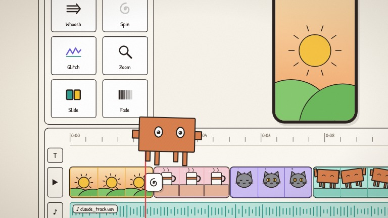

<h1 align="center">claude-video</h1>

<p align="center">
  
</p>

<p align="center"><strong>Hand-drawn and pixel-art explainer videos, written entirely in code.</strong></p>
<p align="center">Remotion + React + SVG visuals, procedurally synthesized music and sound effects, every animation synced to your voice-over subtitles.</p>

<p align="center">
  <a href="./LICENSE"></a>
  <a href="https://github.com/Azure12355/claude-video/stargazers"></a>
  <a href="https://github.com/Azure12355/claude-video/commits"></a>
</p>

<p align="center">
  <strong>English</strong> · <a href="./README.zh-CN.md">简体中文</a>
</p>

<p align="center">
  
  
</p>

## Contents

- [Overview](#overview)
- [Features](#features)
- [Quick Start](#quick-start)
- [What Is Not Included](#what-is-not-included)
- [Making a New Episode](#making-a-new-episode)
- [Project Map](#project-map)
- [Agent Quickstart](#agent-quickstart)
- [License](#license)

## Overview

claude-video is a Remotion project for making short talking-head-style explainer animations (mostly in Chinese) about AI, tech history and science. Nothing is drawn in an editor: characters, props, backgrounds, subtitles, background music and sound effects are all generated by code. The only human inputs are a voice recording and its subtitle file.

The repository contains a reusable component library, a style library, an audio synthesis pipeline and the full source of 20+ episodes as worked examples.

## Features

- **Frame-pure animation** — every component computes its look from the frame number; randomness uses a seeded `rand(seed)`, so renders are deterministic.
- **Subtitle-driven timing** — `makeCues` turns an SRT into helpers like `cf(n)` (frame where sentence *n* starts) and `cw(n, 'word')` (frame where a word is spoken). Re-record the voice-over, re-import the SRT, and every animation re-aligns.
- **Character library** — vector or pixel-art buddy (`Char`), with skins, accessories, expressions and walking/arm animations, switched via a `CharStyle` context.
- **Multiple looks** — pixel sticker style (3:4 portrait), pixel hand-drawn studio (16:9 A-roll + B-roll), vector hand-drawn (9:16), and a Vox-style collage/timeline kit.
- **Procedural audio** — 14 synthesized sound effects plus per-episode background music that automatically ducks under the voice.
- **Clean export** — renders voice / music / SFX stems separately and remixes them with a limiter to avoid Remotion's internal clipping.
- **Style library** — 35 art styles and 9 explainer grammars (recipes and scene code) for picking a look before building an episode.

## Quick Start

Requires Node.js (developed on v24) and, for exporting, `ffmpeg`.

```sh
git clone https://github.com/Azure12355/claude-video.git
cd claude-video
npm install
npm run audio      # generates shared SFX and the ep00 demo music into public/audio/
npm run studio     # opens Remotion Studio at http://localhost:3000
```

Open the `ep00-demo` composition first: it is a self-contained 30-second demo that needs no external assets.

Other useful commands:

```sh
npm test                       # vitest
npm run typecheck              # tsc --noUnusedLocals
npx remotion still src/index.ts ep06-context out.jpg --frame=200 --scale=0.4   # render one frame
npm run export -- ep00-demo    # render out/ep00-demo/ep00-demo.mp4
```

> `npm run audio` will stop with an `ENOENT ... voice.wav` error once it reaches an episode whose voice track is missing. The shared SFX and the ep00 music are generated before that point.

## What Is Not Included

To protect the author's privacy and third-party rights, the following are intentionally **not** in this repository:

| Path | What it was | Effect |
|---|---|---|
| `public/audio/<episode>/voice.wav` | Original voice-over recordings | Episodes play silently in Studio; per-episode music cannot be generated |
| `public/footage/<episode>/` | Real-world photos and video clips (B-roll) | Those panels are empty in ep03, ep07, ep21, ep22 |
| `public/images/ep04-opus55/` | Screenshots used in ep04 | ep04 image panels are empty |
| `materials/`, `out/` | Raw recordings, scripts, rendered videos | — |

The visuals, subtitles (`cues.json`) and scene code of every episode are included, so you can study or adapt them, and plug in your own voice track.

## Making a New Episode

1. Transcribe your voice-over into an SRT file and put raw material in `materials/epXX-topic/`.
2. Normalize the voice to about −16 LUFS and save it as `public/audio/epXX-topic/voice.wav` (48 kHz, stereo, 16-bit).
3. Import subtitles: `npm run cues -- materials/epXX-topic/subtitles.srt src/episodes/epXX-topic/cues.json`.
4. Add `audio/episodes/epXX-topic.mjs` (music sections) and run `npm run audio`.
5. Create `src/episodes/epXX-topic/` — use `ep02-llm` (portrait) or `ep03-cc` (landscape) as a template — register it in `src/Root.tsx`, and add `tests/episodes/epXX-topic.test.ts`.
6. Check frames with `npx remotion still`, preview in Studio, then `npm run export -- epXX-topic`.

## Project Map

| Path | Purpose |
|---|---|
| `src/library/` | Reusable components: `Show` skeleton, cues, subtitles, characters, props, sets, Vox kit ([index](src/library/README.md)) |
| `src/episodes/` | One directory per episode; `ep00-demo` is standalone, the rest use `Show` |
| `src/Root.tsx` | Registers every composition |
| `audio/` | SFX synthesis, music engine, per-episode score sheets |
| `scripts/` | SRT import, export and stem remix |
| `styles/` | Style library ([index](styles/README.md)) |
| `tests/` | Library and per-episode tests |
| `public/fonts/` | Bundled OFL fonts ([licenses](public/fonts/LICENSES.md)) |

## Agent Quickstart

### Objective

Produce deterministic explainer videos where every visual is a pure function of the frame number and is anchored to subtitle timing. Non-goals: a general video editor, or hosting the author's voice recordings and footage.

### Sources of truth

- Engineering conventions and pipeline: [`AGENTS.md`](AGENTS.md)
- Component catalogue: [`src/library/README.md`](src/library/README.md)
- Compositions: `src/Root.tsx`
- Tests: `tests/`

### Safe workflow

1. Read `AGENTS.md` and the library README.
2. Change scenes or library components; never import `src/episodes/` from `src/library/`.
3. Run `npm test` and `npm run typecheck`.
4. Verify visuals with `npx remotion still ... --scale=0.4` instead of rendering the full video.

### Commands

```sh
npm install
npm test
npm run typecheck
npm run studio
```

### Boundaries

- Never commit voice recordings, rendered videos, real footage, `.env` files or secrets.
- No `Math.random()`, CSS animations or wall-clock time in components.
- Only add third-party media whose license allows redistribution, and record its source.

## License

Code is released under the [MIT License](LICENSE).

Third-party material:

- Fonts in `public/fonts/` are under the SIL Open Font License 1.1 — see [`public/fonts/LICENSES.md`](public/fonts/LICENSES.md).
- Art styles and explainer grammars in `styles/` are adapted from [alchaincyf/huashu-art-motion](https://github.com/alchaincyf/huashu-art-motion) (MIT) — see [`styles/LICENSE-huashu-art-motion`](styles/LICENSE-huashu-art-motion).
- Product names and logos that appear in episodes belong to their respective owners and are used for commentary.
